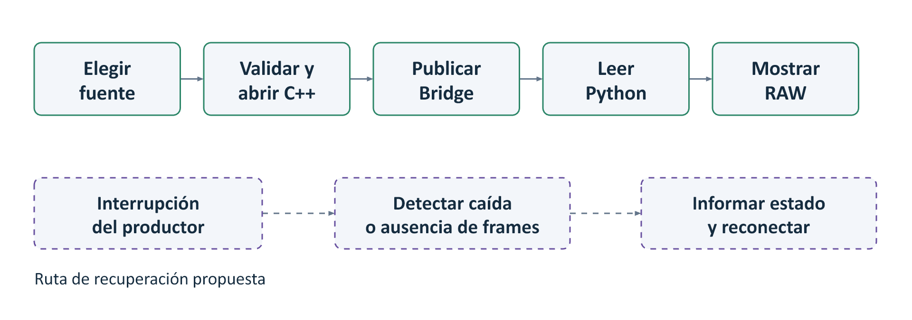
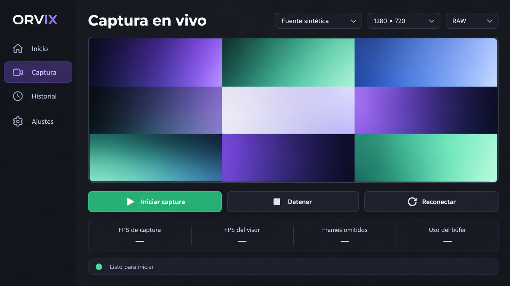
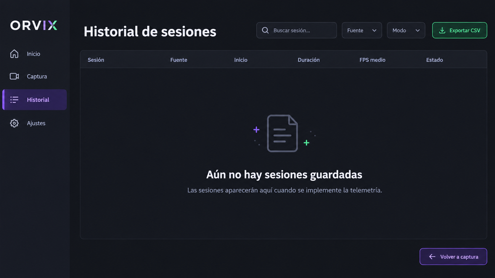
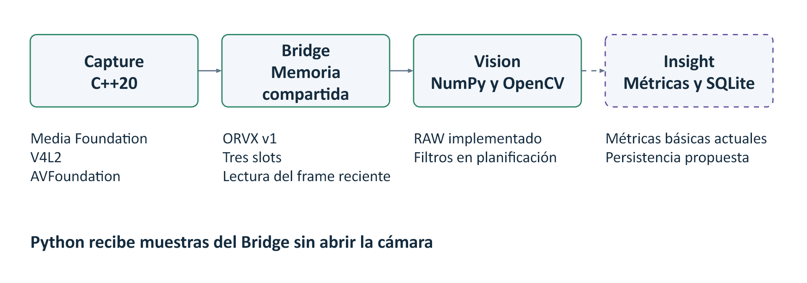
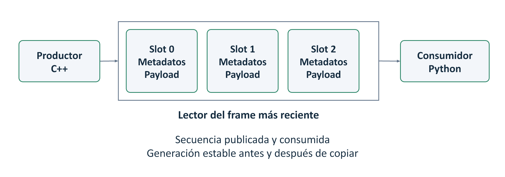
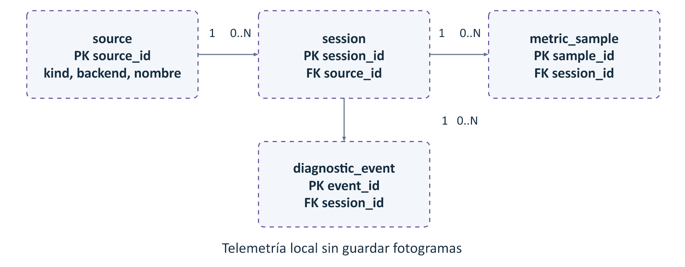

# ORVIX

## Avance 2 Semana 10

Sistema modular de ingesta de video en tiempo real y visión por computadora

Programación de Interfaces y Dispositivos Periféricos

Universidad Tecnológica del Perú

**Integrantes**

Andre Alexander Alvarado Lira

Jose Eduardo Alvarado Mejia

Javier Gomez Correa

11 de octubre de 2026

Versión documental 1.0

<!-- page -->

# Presentación del avance

Presentamos el diseño y el estado técnico de ORVIX para el Avance 2 de semana 10. El proyecto separa la captura de la cámara, el transporte de fotogramas y su procesamiento. La base actual permite que C++ capture video y que Python lo reciba mediante memoria compartida para mostrarlo en modo RAW.

El resultado funcional disponible es la Entrega 2 técnica, versión 0.2.0. Este documento desarrolla además los objetivos, actores, requisitos, flujos, mockups, arquitectura, modelo de datos y planificación del producto. La interfaz completa, los filtros de visión y la persistencia SQLite siguen siendo parte del diseño y del trabajo futuro. Los mockups representan ese diseño, no pantallas del software ya implementado.

## Organización del documento

1. Caso propuesto y problemática.
2. Objetivos, alcance y actores.
3. Requerimientos funcionales y no funcionales.
4. Flujos y mockups.
5. Arquitectura del proyecto.
6. Base de datos y relación de tablas.
7. Planning general y gestión de sprints.

## Línea base verificable

| Elemento | Referencia |
|---|---|
| Repositorio | https://github.com/Jeamlake/orvix |
| Versión técnica | 0.2.0 |
| Commit revisado | ecd60a1937b8a3719ba4a13fb8e2a9bf9a9eaddc |
| Pruebas actuales en Windows | 16 nativas, 6 unitarias Python y 1 integración sintética aprobadas |
| Validación física documentada | Webcam GENERAL WEBCAM, 8 de septiembre de 2026 |

Las pruebas automáticas comprueban comportamientos concretos. Su aprobación no equivale a terminar todos los requisitos del producto ni reemplaza una nueva prueba física de cámara.

<!-- page -->

# 1 Caso propuesto y problemática

## Caso de uso académico

En una práctica de interfaces y periféricos necesitamos explicar qué ocurre entre una webcam y la imagen que aparece en pantalla. Abrir la cámara desde una biblioteca de alto nivel permite construir un prototipo, pero deja fuera de la aplicación gran parte de la negociación del formato, la lectura de muestras y la gestión de recursos del sistema operativo.

ORVIX propone hacer observable ese recorrido. Un proceso C++ controla la fuente de video y registra los metadatos de cada fotograma. Un segundo proceso Python recibe las muestras, interpreta su organización en memoria y presenta el resultado. Esta separación permite estudiar errores de captura y consumo sin asignar ambas responsabilidades a un único componente.

## Problemática delimitada

La limitación que abordamos es de control y diagnóstico. Cuando captura y procesamiento comparten el mismo ciclo, una operación lenta puede retrasar la lectura y dificultar la identificación del origen de un fallo. Además, el formato de píxel y el stride pueden quedar implícitos en conversiones de la biblioteca.

No sostenemos que cualquier uso de cv2.VideoCapture sea incorrecto ni que ORVIX supere en rendimiento a todas las alternativas. El proyecto busca exponer una ruta nativa y medir su comportamiento con pruebas reproducibles. Una comparación de velocidad requerirá benchmarks equivalentes, todavía no realizados.

## Solución propuesta

| Responsabilidad | Solución en ORVIX | Beneficio observable |
|---|---|---|
| Acceso a la cámara | Backend nativo en C++ | Dispositivo, formato y fallos explícitos |
| Transporte de video | Anillo en memoria compartida | Publicación sin esperar al visor |
| Interpretación de muestras | NumPy y OpenCV | Dimensiones, formato y stride controlados |
| Seguimiento de ejecución | Secuencias, FPS y diagnósticos | Distinguir pérdidas y estados de cada componente |

La persistencia de sesiones y la interfaz de escritorio ampliarán esta solución. No necesitamos un servidor remoto ni una conexión a Internet para la ruta normal de video.

<!-- page -->

# 2 Objetivos alcance y actores

## Objetivo general

Desarrollar una aplicación modular de escritorio que capture video mediante APIs nativas, transporte sus fotogramas por memoria compartida y permita visualizar, procesar y analizar el flujo desde una interfaz comprensible para el usuario.

## Objetivos específicos

1. Mantener la propiedad de la cámara en el proceso C++ y evitar su apertura directa desde Python en el flujo normal.
2. Definir un contrato IPC versionado que incluya carga útil, secuencia, timestamp, dimensiones, formato y stride.
3. Visualizar el modo RAW e incorporar posteriormente escala de grises, bordes y detección OpenCV sin reiniciar la captura.
4. Mostrar métricas con unidades claras y conservar telemetría agregada de sesiones mediante SQLite.
5. Proporcionar controles de inicio, detención y recuperación, con errores visibles y pruebas reproducibles.

## Alcance por estado

| Estado | Funcionalidades |
|---|---|
| Base implementada | Enumeración y selección por CLI, captura nativa, formato negociado, metadatos, Bridge, visor RAW, fuente sintética y métricas básicas |
| Diseño para el producto | Interfaz de escritorio, filtros, detección, historial SQLite, exportación de métricas y recuperación del consumidor |
| Fuera del alcance inicial | Reconocimiento de identidad, vigilancia remota, grabación automática de video, nube y aplicaciones móviles |

## Actores

| Actor o participante | Interacción y responsabilidad |
|---|---|
| Operador | Selecciona la fuente, inicia y detiene una sesión, cambia el modo y consulta métricas |
| Evaluador docente | Revisa requisitos, diagramas, evidencias y demostración reproducible |
| Equipo de desarrollo | Mantiene código, documentación, pruebas y control de versiones |
| Sistema operativo y webcam | Participantes técnicos que proporcionan permisos, formatos y muestras de video |

La aplicación es local y no contempla cuentas de usuario en esta versión. Los integrantes del equipo no representan roles de administración dentro del software.

<!-- page -->

# 3 Requerimientos funcionales y no funcionales

## Requisitos de captura y transporte

Conservamos los identificadores RF del repositorio. En las tablas, **Base** indica código existente y **Plan** indica funcionalidad pendiente. Los criterios describen cómo aceptar cada requisito; deben ejecutarse cuando se implemente o cambie el componente.

| ID | Requisito | Estado | Criterio de aceptación |
|---|---|---|---|
| RF-001 | Enumerar dispositivos de captura | Base | Informar dispositivos identificables o una lista vacía sin fallo inesperado |
| RF-002 | Seleccionar un dispositivo | Base | Aceptar un índice existente y rechazar uno inválido con diagnóstico |
| RF-003 | Abrir la fuente mediante API nativa C++ | Base | Abrir la cámara seleccionada y liberar sus recursos al cerrar |
| RF-004 | Adquirir fotogramas continuos | Base | Recibir muestras consecutivas hasta el límite o fin de sesión |
| RF-005 | Exponer metadatos por fotograma | Base | Informar secuencia, timestamp, resolución, formato, stride y bytes |
| RF-006 | Publicar fotogramas en memoria compartida | Base | Publicar metadatos y payload coherentes bajo protocolo ORVX v1 |
| RF-007 | Consumir fotogramas desde Python | Base | Recibir muestras del productor sin abrir la cámara desde Python |
| RF-008 | Interpretar muestras con NumPy | Base | Obtener una imagen con geometría correcta para el formato admitido |
| RF-009 | Mostrar el video recibido | Base | Presentar imágenes nuevas y permitir cerrar el visor |
| RF-010 | Proporcionar visualización RAW | Base | Mostrar el contenido decodificado sin aplicar filtros del pipeline |

## Restricción de arquitectura

RF-ARCH-001 exige que Python no acceda directamente a la cámara durante la ruta normal. La fuente sintética sustituye al dispositivo físico para probar el contrato entre procesos, no para validar el hardware.

La evidencia automatizada actual incluye NV12 sintético. La existencia de otros decodificadores no certifica que todas las cámaras y formatos tengan la misma cobertura de pruebas.

<!-- page -->

## Requisitos de visión y métricas

| ID | Requisito | Estado | Criterio de aceptación |
|---|---|---|---|
| RF-011 | Aplicar escala de grises | Plan | Generar salida monocromática con la resolución del frame |
| RF-012 | Detectar bordes | Plan | Generar un mapa de bordes con parámetros controlados |
| RF-013 | Ejecutar un detector OpenCV | Plan | Definir el detector y demostrar resultados sobre una secuencia de prueba |
| RF-014 | Cambiar de modo sin reiniciar captura | Plan | Cambiar la salida y mantener la secuencia del mismo productor |
| RF-015 | Medir FPS de captura | Base | Calcular FPS con secuencias y tiempo multimedia e informar la unidad |
| RF-016 | Medir FPS de procesamiento | Plan | Informar rendimiento del pipeline, separado del FPS de captura y del visor |
| RF-017 | Detectar frames omitidos | Base | Contabilizar saltos entre secuencias consumidas |
| RF-018 | Estimar latencia de procesamiento | Plan | Medir duración del procesamiento con reloj monotónico y unidad ms |
| RF-019 | Contar detecciones por minuto | Plan | Agregar detecciones en una ventana temporal definida |
| RF-020 | Informar utilización del búfer | Base | Derivar ocupación de secuencias publicada y consumida y limitarla a 0–100 % |

## Interpretación de las métricas

Los FPS nominales pertenecen al formato negociado. Los FPS de captura representan muestras realmente adquiridas. El FPS del visor describe el ritmo de imágenes presentadas y no constituye por sí mismo una medición del futuro pipeline de detección.

Un salto de secuencia consumida indica que el lector omitió fotogramas. Las sobrescrituras del productor y los frames omitidos del lector son métricas distintas; no deben sumarse como si midieran pérdidas diferentes de una misma cola.

La latencia de procesamiento propuesta mide una operación del pipeline. Para afirmar latencia extremo a extremo será necesario alinear las bases de tiempo de captura y presentación. Los timestamps multimedia actuales no deben restarse directamente de una fecha UTC.

<!-- page -->

## Requisitos de sesiones diagnóstico y portabilidad

| ID | Requisito | Estado | Criterio de aceptación |
|---|---|---|---|
| RF-021 | Persistir telemetría histórica | Plan | Recuperar una sesión y sus muestras después de reiniciar la aplicación |
| RF-022 | Exponer información de sesión | Plan | Informar fuente, inicio, configuración, duración y estado de cierre |
| RF-023 | Detectar fallos y desconexión de cámara | Base | Producir diagnóstico y salida controlada ante fallos de lectura |
| RF-024 | Aislar Capture de la terminación de Vision | Base | Completar el productor aunque el consumidor termine antes |
| RF-025 | Ofrecer una fuente sintética | Base | Ejecutar pruebas del puente sin cámara física |
| RF-026 | Registrar eventos y fallos | Base | Emitir código de diagnóstico y log estructurado sin guardar frames |
| RF-027 | Separar backends de plataforma | Base | Compilar el backend correspondiente en Windows, Linux y macOS |

## Trazabilidad del avance

| Grupo de requisitos | Componente | Evidencia o validación prevista |
|---|---|---|
| RF-001 a RF-005, RF-015 y RF-023 | Capture | Pruebas nativas y evidencia física de septiembre |
| RF-006, RF-007, RF-017 y RF-020 | Bridge y lector | Pruebas de publicación, protocolo, secuencia e integración |
| RF-008 a RF-010 | Vision y visor | Decodificación NV12 y prueba de presentación con dobles de prueba |
| RF-024 a RF-027 | Infraestructura y captura | Integración, fuente sintética, logging y configuración CI |
| RF-011 a RF-014, RF-016, RF-018 y RF-019 | Vision e Insight | Pruebas pendientes del pipeline y sus métricas |
| RF-021 y RF-022 | Insight y sesiones | Pruebas pendientes de persistencia e historial |

Esta relación incluye los 27 RF. RF-011, RF-012, RF-014, RF-016, RF-018 y RF-022 deben incorporarse también a la matriz técnica original, que actualmente no contiene sus filas. La salida temprana del consumidor ya tiene evidencia; la recuperación automática y la detección de muerte del productor necesitan pruebas adicionales.

<!-- page -->

## Requisitos no funcionales

Los objetivos cuantitativos pendientes se presentan como metas de aceptación, no como resultados medidos.

| ID | Condición | Comprobación |
|---|---|---|
| RNF-001 | Objetivo inicial 1280×720 a 30 FPS nominales | Registrar formato negociado y FPS efectivos por separado |
| RNF-002 | Transporte de baja latencia | Usar memoria compartida y medir demora del pipeline antes de afirmar un valor |
| RNF-003 | Minimizar copias innecesarias | Revisar el recorrido del payload y medir las copias inevitables de lectura estable |
| RNF-004 | Módulos con responsabilidades separadas | Capture, Bridge, Vision e Insight con contratos definidos |
| RNF-005 | Observabilidad estructurada | Registrar eventos con código, contexto y severidad |
| RNF-006 | Reproducción desde checkout limpio | Compilar e instalar con los pasos documentados |
| RNF-007 | Mantenibilidad | Mantener captura específica de plataforma fuera del núcleo común |
| RNF-008 | Pruebas sin hardware | Aprobar los casos sintéticos sin webcam conectada |
| RNF-009 | Integración continua | Ejecutar compilación y pruebas para los sistemas configurados |
| RNF-010 | Frames efímeros | No crear imágenes ni videos automáticamente |
| RNF-011 | Diagnóstico ante fallos | Informar causa y recuperar o cerrar sin espera indefinida |
| RNF-012 | Protocolo versionado | Rechazar una versión IPC no compatible |
| RNF-013 | Portabilidad | Mantener backends nativos de Windows, Linux y macOS |

## Metas adicionales de experiencia

La interfaz propuesta debe permitir navegar por teclado, redimensionar la ventana y leer el estado sin depender solo del color. El diseño toma 1024×768 como tamaño mínimo de evaluación y debe revisarse con escalado de pantalla de 100 %, 125 % y 150 %. Estas comprobaciones quedan pendientes hasta implementar la interfaz.

El backend dispone de una ruta de compatibilidad heredada para Windows 7. No contamos con una prueba física actual de ese sistema. Una interfaz Qt 6 moderna debe declarar sus propias plataformas compatibles y no heredar automáticamente la compatibilidad del código C++.

<!-- page -->

## Requisitos de la interfaz propuesta

Los identificadores UX complementan los RF existentes sin cambiar su numeración. Todos corresponden a diseño pendiente de implementación.

| ID | Comportamiento esperado | Aceptación propuesta |
|---|---|---|
| UX-001 | Elegir cámara o fuente sintética | Mostrar fuentes disponibles y conservar una selección válida |
| UX-002 | Iniciar y detener desde la aplicación | Lanzar procesos propios y cerrar solo los recursos de la sesión |
| UX-003 | Mostrar estados y errores comprensibles | Identificar conectado, capturando, detenido y error con texto y acciones |
| UX-004 | Consultar métricas sin tapar el video | Mostrar unidades, fuente de cada valor y estado sin datos |
| UX-005 | Consultar historial | Filtrar sesiones persistidas por fuente, fecha y modo |
| UX-006 | Exportar métricas | Crear un CSV elegido por el usuario sin exportar imágenes |
| UX-007 | Recuperar interrupciones del productor | Detectar ausencia de frames o proceso muerto y ofrecer reconexión |
| UX-008 | Mantener usabilidad al redimensionar | Evitar controles cortados y conservar navegación por teclado |

## Escenarios de aceptación

1. **Inicio sin cámara.** La aplicación informa la ausencia de hardware y ofrece la fuente sintética. No intenta abrir un índice inexistente.
2. **Sesión RAW.** El operador elige una fuente, inicia captura, visualiza video y distingue FPS nominales de FPS efectivos.
3. **Salida del visor.** El consumidor cierra y Capture completa su trabajo, como demuestra la integración actual.
4. **Productor interrumpido.** La futura interfaz reconoce la interrupción, conserva la respuesta al teclado y permite reconectar. El visor actual todavía no cumple esta recuperación.
5. **Historial local.** Una sesión persistida permanece consultable después de cerrar y abrir la aplicación. Requiere implementar SQLite.

Cada escenario debe registrar configuración, resultado esperado, resultado observado y versión del código. Un mockup aceptado no sustituye una prueba funcional.

<!-- page -->

# 4 Flujos y mockups

## Flujo de inicio y visualización

El operador selecciona una fuente y solicita iniciar. Capture valida la fuente y negocia el formato antes de crear el transporte compartido. Vision se conecta al productor, interpreta las muestras y actualiza la presentación. Para cerrar una sesión desde la futura aplicación, el coordinador deberá detener sus propios procesos y liberar la cámara.

En la implementación actual, los comandos CLI realizan la selección y apertura. El visor OpenCV consume RAW. El control centralizado de la sesión corresponde a la interfaz propuesta.

## Flujos alternativos

**Fuente no disponible.** Se informa que no hay cámara o que la selección es inválida. El operador puede elegir la fuente sintética o volver a enumerar dispositivos.

**Error de formato o lectura.** Capture emite un diagnóstico. El cliente debe presentar el código y la causa, sin mostrar el último fotograma como si continuara llegando video.

**Interrupción del productor.** El diseño añade comprobación de proceso y timeout de ausencia de frames. Propone un umbral inicial configurable de dos segundos para advertir estancamiento, que deberá evaluarse con las fuentes reales. La reconexión requiere una nueva región IPC válida.

**Terminación del consumidor.** Capture no depende de la permanencia del visor. Esta propiedad permite reiniciar el consumidor sin detener necesariamente la adquisición.

<!-- page -->

## Mockup de captura en vivo

La pantalla concentra el video en el área principal. La navegación lateral mantiene disponibles Inicio, Captura, Historial y Ajustes. La franja de configuración muestra fuente, resolución y modo; los controles de sesión permanecen visibles debajo del video.

**Estado del diseño.** Esta imagen es un mockup de la futura interfaz. Sus guiones indican ausencia de datos y no representan mediciones reales. El visor actual usa una ventana OpenCV con texto superpuesto.

## Reglas de interacción

1. Iniciar solo está disponible con una fuente válida y sin sesión activa. Una segunda pulsación no debe crear otro productor.
2. Detener cierra la sesión propia y libera la cámara. Cambiar de pantalla no debe matar procesos de forma accidental.
3. Reconectar se ofrece cuando hay una interrupción. Debe informar el intento y su resultado.
4. Las métricas muestran unidades y un guion cuando falta un valor, nunca un cero inventado.
5. RAW estará disponible inicialmente. Los filtros pendientes no aparecerán como acciones funcionales hasta implementarse.
6. El video conserva su relación de aspecto. El panel debe admitir zoom o ajuste al área sin deformar el frame.

La lectura IPC, la decodificación y el acceso a SQLite deben ejecutarse fuera del hilo de interfaz. Los eventos de teclado y cierre necesitan atenderse aunque no llegue un nuevo fotograma.

<!-- page -->

## Mockup del historial

El historial mostrará una fila por sesión, con fuente, inicio, duración, rendimiento agregado y estado final. Desde una sesión seleccionada se consultarán sus muestras y diagnósticos. La imagen representa un estado vacío porque la persistencia no está implementada todavía.

## Navegación y consulta

La búsqueda debe filtrar información ya almacenada, sin abrir la cámara. Las etiquetas de modo diferenciarán la configuración inicial de los cambios realizados durante la sesión. Exportar CSV solicitará una ruta local y advertirá antes de reemplazar un archivo existente.

El historial no guardará fotogramas ni videos. Su objetivo es comparar métricas y explicar incidentes técnicos, de acuerdo con la política de frames efímeros.

## Estados que debemos diseñar

| Pantalla | Estados necesarios |
|---|---|
| Inicio | Sin fuentes, fuente disponible, preparación y error de permisos |
| Captura | Conectando, capturando, sin nuevos frames, detenida y fallo |
| Historial | Vacío, cargando, resultados, filtro sin coincidencias y error de lectura |
| Ajustes | Configuración válida, cambios sin guardar y formato no compatible |

El color refuerza el estado, pero el texto debe explicarlo. La aplicación evitará diálogos repetidos para un mismo fallo y conservará un lugar visible para consultar el diagnóstico.

<!-- page -->

# 5 Arquitectura del proyecto

## Componentes y recorrido del video

**Capture** posee la cámara. Una interfaz común Camera delega en Media Foundation para Windows, V4L2 para Linux y AVFoundation para macOS. El CLI mantiene fuera de su lógica común los detalles de cada backend.

**Bridge** publica un contrato binario ORVX v1 en una región compartida. El productor no espera al consumidor; sobrescribe posiciones del anillo según la secuencia. Esta política prioriza la imagen más reciente y admite omisiones cuando el lector es más lento.

**Vision** lee memoria compartida, copia un fotograma estable, lo interpreta con NumPy y lo convierte para presentación con OpenCV. El modo RAW está implementado. El pipeline de filtros y detección está planificado.

**Insight** reúne las métricas disponibles y deberá incorporar persistencia de sesiones y consultas históricas. SQLite es una decisión arquitectónica aceptada, no un subsistema operativo en la versión revisada.

## Extensión de escritorio

Proponemos un coordinador de sesión que lance y supervise los procesos propios. La interfaz consumirá eventos de ese coordinador y métricas del pipeline. Una caída de Capture debe cambiar el estado de la vista, sin bloquear el hilo gráfico.

Qt para Python es una alternativa para la nueva interfaz, pendiente de una prueba técnica y de fijar versiones. La propuesta moderna se orienta a Windows 10 y 11, Linux y macOS compatibles con la versión elegida de Qt. La ruta heredada de Windows 7 debe mantenerse y validarse de forma independiente; Qt 6.8 no lo incluye entre sus plataformas Windows admitidas [R6].

<!-- page -->

## Contrato IPC y sincronización

El header global mide 128 bytes y cada header de slot mide 64 bytes. El productor reserva tres slots por defecto. La carga útil contiene los bytes de la imagen; el consumidor utiliza metadatos para interpretar dimensiones, formato y stride.

| Información | Propósito |
|---|---|
| Magic y versión | Reconocer ORVX y rechazar contratos no compatibles |
| Geometría del anillo | Validar cantidad de slots, capacidad y tamaño total |
| PID y estado del productor | Identificar el origen y su estado declarado |
| Secuencias publicada y consumida | Seguir avance del flujo y calcular ocupación |
| Generación de cada slot | Evitar aceptar una copia realizada durante una escritura |
| Secuencia y timestamp del frame | Ordenar muestras y calcular ritmo de adquisición |
| Ancho alto formato y stride | Interpretar el payload sin suponer empaquetado |
| Contador de sobrescrituras | Informar producción que excede el consumo del anillo |

El lector aplica una comprobación de generación antes y después de copiar la carga útil. Si el slot cambió, vuelve a intentar la lectura. La implementación actual sí realiza una copia estable del payload; por ello no afirmamos transporte completo de cero copias.

El estado declarado puede quedar en RUNNING si el productor muere abruptamente. La supervisión propuesta debe complementar ese estado con liveness del proceso y tiempo desde el último frame. También deberán probarse datos IPC inconsistentes y cierres simultáneos.

<!-- page -->

# 6 Base de datos y relación de tablas

## Modelo relacional propuesto

Proponemos SQLite para conservar información agregada sin infraestructura remota. Una fuente puede originar varias sesiones. Cada sesión reúne muestras métricas y eventos diagnósticos. Las imágenes continúan siendo efímeras y no forman parte del modelo.

| Relación | Cardinalidad | Regla |
|---|---|---|
| source y session | 1 a 0 o muchas | Toda sesión referencia una fuente existente |
| session y metric_sample | 1 a 0 o muchas | Cada muestra pertenece a una sola sesión |
| session y diagnostic_event | 1 a 0 o muchas | Cada evento pertenece a una sola sesión |

## Integridad y conservación

source_id y session_id son claves primarias de texto. sample_id y event_id son claves primarias enteras. Las referencias de las tablas hijas son claves foráneas. Cada conexión SQLite debe activar PRAGMA foreign_keys = ON para aplicar su validación [R5].

Eliminar una fuente con sesiones asociadas estará restringido. La futura eliminación de una sesión podrá eliminar sus muestras y eventos de forma transaccional, con confirmación explícita del usuario. Esa operación no se ejecuta como parte de este avance.

Las fechas de inicio y cierre se guardarán en UTC. Las muestras y eventos usarán tiempo transcurrido monotónico relativo a la sesión. Una columna de latencia podrá quedar nula mientras no exista una medición válida; cero se reservará para un resultado realmente medido.

El modelo es un diseño para RF-021 y RF-022. El repositorio actual no incluye el módulo de persistencia, migraciones ni consultas del historial.

<!-- page -->

## Diccionario de fuentes y sesiones

| Tabla y campo | Tipo | Restricción y significado |
|---|---|---|
| source.source_id | TEXT | PK, identificador de fuente |
| source.kind | TEXT | camera o synthetic |
| source.device_key | TEXT | Identificador técnico de la fuente |
| source.display_name | TEXT | Nombre legible para el operador |
| source.backend | TEXT | Media Foundation, V4L2, AVFoundation o synthetic |
| session.session_id | TEXT | PK, identificador único de sesión |
| session.source_id | TEXT | FK a source, obligatorio |
| session.started_at_utc | TEXT | Inicio en formato ISO 8601 UTC |
| session.ended_at_utc | TEXT | Cierre UTC, nulo mientras siga activa |
| session.initial_mode | TEXT | Modo seleccionado al iniciar |
| session.width | INTEGER | Ancho negociado, mayor que cero |
| session.height | INTEGER | Alto negociado, mayor que cero |
| session.nominal_fps | REAL | FPS solicitados o negociados, con contexto |
| session.state | TEXT | created, running, stopped o failed |
| session.code_revision | TEXT | Commit utilizado para reproducir la sesión |

## Normalización y consulta

El nombre de la fuente permanece en source. La configuración de una ejecución pertenece a session. Las mediciones y los mensajes de diagnóstico se guardan en tablas independientes para evitar repetir datos de cabecera en cada muestra.

El historial consultará primero las sesiones y sus datos agregados. Solo cargará las muestras y eventos detallados cuando el operador abra una sesión. Esta separación limita el volumen de datos que debe presentar la interfaz.

No almacenaremos contraseñas, tokens ni rutas de archivos personales en estas tablas. device_key identifica el periférico; la vista de usuario debe mostrar display_name y no exponer detalles técnicos innecesarios.

<!-- page -->

## Diccionario de métricas y diagnósticos

| Tabla y campo | Tipo | Restricción y significado |
|---|---|---|
| metric_sample.sample_id | INTEGER | PK |
| metric_sample.session_id | TEXT | FK a session, obligatorio |
| metric_sample.elapsed_ms | REAL | Tiempo relativo a la sesión, no negativo |
| metric_sample.processing_mode | TEXT | Modo vigente en esta muestra |
| metric_sample.capture_fps | REAL | FPS efectivos de captura, no negativos |
| metric_sample.viewer_fps | REAL | FPS del visor, no negativos |
| metric_sample.processing_latency_ms | REAL | Duración medida del pipeline o nulo |
| metric_sample.skipped_total | INTEGER | Acumulado de secuencias omitidas |
| metric_sample.overwrites_total | INTEGER | Acumulado de sobrescrituras del productor |
| metric_sample.buffer_ratio | REAL | Ocupación entre 0 y 1 |
| metric_sample.detections_count | INTEGER | Detecciones del intervalo o nulo |
| diagnostic_event.event_id | INTEGER | PK |
| diagnostic_event.session_id | TEXT | FK a session, obligatorio |
| diagnostic_event.elapsed_ms | REAL | Momento relativo de ocurrencia |
| diagnostic_event.severity | TEXT | INFO, WARN o ERROR |
| diagnostic_event.code | TEXT | Código diagnóstico estable |
| diagnostic_event.message | TEXT | Descripción del evento sin imágenes ni secretos |

## Frecuencia e índices propuestos

Insight deberá agregar métricas aproximadamente una vez por segundo, en lugar de escribir cada frame. Esta frecuencia es una decisión de diseño que debe medirse y ajustarse. Los conteos por minuto se obtendrán a partir de los intervalos definidos de detección.

Proponemos índices sobre session.started_at_utc, metric_sample(session_id, elapsed_ms) y diagnostic_event(session_id, elapsed_ms). Una restricción única sobre sesión y tiempo de muestra evitará duplicar la misma medición durante un reintento.

Las pruebas de persistencia deben comprobar creación, lectura tras reinicio, límites numéricos y rechazo de una FK inexistente. El modelo no implica que estas pruebas ya estén implementadas.

<!-- page -->

# 7 Planning general y gestión de sprints

## Organización del trabajo

La captura nativa y el Bridge constituyen la base ya desarrollada. A partir de ella proponemos el siguiente plan. Los sprints describen trabajo futuro y no reconstruyen retrospectivamente ceremonias Scrum que no tienen evidencia. La duración inicial de una semana por sprint es orientativa y debe ajustarse a la disponibilidad del equipo y a la fecha académica.

| Sprint | Objetivo | Resultado de cierre |
|---|---|---|
| S1 | Cerrar documentación y estabilidad de la base | SRS, flujos, mockups, modelo de datos, Word, exposición y pruebas de fallos |
| S2 | Implementar la aplicación de escritorio | Fuente, inicio, detención, estados, video y métricas utilizables sin terminal |
| S3 | Añadir visión y persistencia | Filtros, detector definido, métricas del pipeline y sesiones SQLite |
| S4 | Validar y empaquetar el producto | Recuperación, pruebas de interfaz, benchmarks y distribución reproducible |

## Gestión de tareas

Cada historia tendrá un requisito asociado, criterio de aceptación y evidencia. El tablero usará Pendiente, En curso, En revisión y Hecho. El equipo asignará un responsable durante la planificación, sin atribuir ahora funciones individuales no confirmadas.

La revisión de sprint incluirá una demostración ejecutable y actualización del estado documental. La retrospectiva registrará problemas de estimación, integración y pruebas, con una acción concreta para el siguiente ciclo.

## Dependencias

La interfaz necesita un contrato de coordinación de procesos antes de implementar sus botones. El historial depende del modelo de sesiones y del repositorio SQLite. Las métricas de detección requieren un detector y una ventana temporal definidos. El empaquetado depende de fijar versiones compatibles del toolkit y de las bibliotecas.

Las entregas académicas y los hitos técnicos son calendarios distintos. Aprobar los siete apartados de semana 10 no significa que todo ORVIX 1.0 esté terminado.

<!-- page -->

## Backlog prioritario y definición de terminado

| Prioridad | Trabajo | Evidencia de aceptación |
|---|---|---|
| Alta | Detectar productor interrumpido | Prueba sintética de caída, salida o recuperación sin espera infinita |
| Alta | Atender eventos aunque no lleguen frames | Cerrar la vista y usar teclado con el flujo detenido |
| Alta | Propagar fallos de herramientas en PowerShell | Simular CTest fallido y obtener salida global distinta de cero |
| Alta | Completar matriz de trazabilidad | Los 27 RF presentes con estado y evidencia coherentes |
| Alta | Coordinar Capture y Vision desde la interfaz | Iniciar y detener sin cerrar procesos ajenos |
| Media | Implementar SQLite e historial | Consultar sesiones después de reiniciar y verificar FK |
| Media | Medir rendimiento real | Informe con hardware, fuente, configuración y métricas separadas |

## Hallazgos de la revisión técnica

El 11 de octubre se reprodujo una interrupción abrupta del productor sintético. El consumidor permaneció ejecutándose y el estado compartido siguió en RUNNING. El código del visor tampoco atiende waitKey cuando no presenta un frame nuevo. Corregir ambas condiciones es necesario para una recuperación usable.

También se simuló una salida fallida de CTest dentro del script de pruebas PowerShell. Al aprobar pytest después, el código final quedó en cero. Los scripts deben comprobar el código de salida de cada herramienta antes de continuar. Estos hallazgos siguen pendientes de corrección.

## Cierre del Avance 2

1. Revisar con la consigna los siete apartados y mantener consistencia entre Word y presentación.
2. Completar la trazabilidad y distinguir base, diseño y trabajo futuro en cada evidencia.
3. Corregir los fallos prioritarios y volver a ejecutar pruebas automatizadas y una demostración controlada.
4. Probar una cámara física sin confundir FPS nominales con rendimiento medido.
5. Ensayar la exposición, con una alternativa sintética si no está disponible la webcam.

El documento y los mockups completan el diseño académico. La aplicación completa requiere ejecutar los sprints de implementación y validar sus resultados.

<!-- page -->

# Referencias y evidencias

## Documentación del proyecto

[R1] Equipo ORVIX. README y arquitectura. Revisión ecd60a1. https://github.com/Jeamlake/orvix/blob/ecd60a1937b8a3719ba4a13fb8e2a9bf9a9eaddc/README.es.md

[R2] Equipo ORVIX. Requisitos de software y matriz de trazabilidad. https://github.com/Jeamlake/orvix/tree/ecd60a1937b8a3719ba4a13fb8e2a9bf9a9eaddc/docs/es/requirements

[R3] Equipo ORVIX. Evidencia de la Entrega 2. https://github.com/Jeamlake/orvix/blob/ecd60a1937b8a3719ba4a13fb8e2a9bf9a9eaddc/docs/es/evidence/delivery-02/README.md

[R4] Equipo ORVIX. Presentación del primer avance y diagramaDeFlujo.drawio. Material previo incluido en avance 1.zip. Los integrantes y el planteamiento inicial proceden de esa presentación. El estado técnico se actualiza con la revisión actual.

[R5] SQLite. Foreign Key Support. https://www.sqlite.org/foreignkeys.html

[R6] Qt. Supported Platforms for Qt 6.8. https://doc.qt.io/qt-6.8/supported-platforms.html

[R7] Consigna del curso. Índice de contenido para Avance 2 de semana 10. Imagen de referencia titulada WhatsApp Image 2026-09-20 at 10.44.42 PM.jpeg.

## Evidencia reciente y límites

| Validación | Resultado | Alcance |
|---|---|---|
| CTest local | 16 de 16 aprobadas | Ejecutables disponibles en Windows |
| pytest unitario | 6 de 6 aprobadas | Protocolo, decodificación, secuencias y visor |
| Integración sintética | 1 de 1 aprobada | C++, memoria compartida y Python |
| Prueba física documentada | 19.46 FPS efectivos | Webcam en septiembre, 1280×720 y 30 FPS nominales |

La revisión reciente no repitió la prueba física ni una compilación limpia en los tres sistemas operativos. La documentación anterior contiene validación CI multiplataforma. Los mockups y el modelo relacional de este avance son propuestas de diseño, y los hallazgos de robustez no se consideran solucionados por la aprobación de las pruebas existentes.

La presentación complementaria resume los siete apartados con diagramas editables y notas para exposición. Los detalles de aceptación y el diccionario de datos permanecen en este documento.
